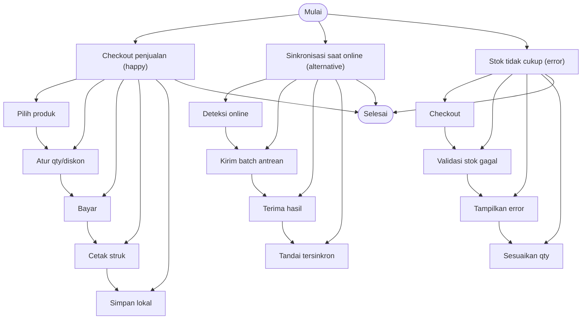

# 01 - PRD & Flow

> Project: **pos-kasir-multitenant** | FR: 10 | Digenerate: 2026-10-15T07:14:41.078Z

## 1. Tujuan & Aktor
- Goal: Kasir/POS yang tetap bisa melayani transaksi saat internet putus, lalu menyinkronkan data ke server saat online.
- Aktor: `Kasir`, `Admin`, `Owner`, `Sistem`

## 2. Alur (Mermaid)

## 3. Functional Requirements (MoSCoW)
| ID | Fitur | Prioritas | Aktor | Acceptance Criteria |
|---|---|---|---|---|
| FR-01 | Login Kasir (PIN) | MUST | Kasir, Admin | Given kasir terdaftar When input PIN benar Then masuk & token tersimpan / Given PIN salah 5x When submit Then akun terkunci 5 menit |
| FR-02 | Buka/Tutup Shift | MUST | Kasir | Given belum ada shift When buka shift Then shift OPEN dibuat / Given shift OPEN When tutup shift Then selisih kas dihitung |
| FR-03 | Kelola Produk & Kategori | MUST | Admin | Given admin When simpan produk valid Then produk tersimpan / Given barcode duplikat When simpan Then ditolak 409 |
| FR-04 | Kelola Stok (Penyesuaian & Opname) | MUST | Admin, Kasir | Given produk stok 10 When jual 3 Then stok jadi 7 & movement tercatat / Given penyesuaian When stok hasil negatif Then ditolak 422 |
| FR-05 | Transaksi Penjualan (Checkout) | MUST | Kasir | Given keranjang valid When checkout Then sale tersimpan & stok berkurang / Given request diulang dengan client_reference_id sama Then tidak dobel |
| FR-06 | Pembayaran & Kembalian | MUST | Kasir | Given total 90rb When bayar 100rb tunai Then kembalian 10rb / Given bayar < total When submit Then ditolak 422 |
| FR-07 | Sinkronisasi Offline | MUST | Sistem | Given ada antrean When online Then batch terkirim & status tersinkron / Given kirim ulang batch sama Then tidak duplikat |
| FR-08 | Laporan Penjualan | SHOULD | Admin, Owner | Given ada transaksi When buka laporan Then total & jumlah nota sesuai |
| FR-09 | Manajemen Pengguna | SHOULD | Admin | Given admin When tambah kasir Then pengguna baru bisa login |
| FR-10 | Manajemen Tenant (Super Admin) | MUST | Super Admin | Given super admin When buat tenant Then tenant aktif & adminnya dapat login / Given tenant dinonaktifkan When kasir login Then ditolak 403 |

## 4. Non-Functional Requirements
- Performance: Checkout < 200ms lokal; Sinkronisasi batch <= 500 operasi/permintaan
- Security: PIN di-hash Argon2id; JWT rotasi refresh; HTTPS/TLS 1.3
- Scalability: Modular monolith horizontal-ready; Index pada kolom filter laporan
- Offline: Operasi penuh saat offline; Antrean sinkron idempoten; Konflik per-version
