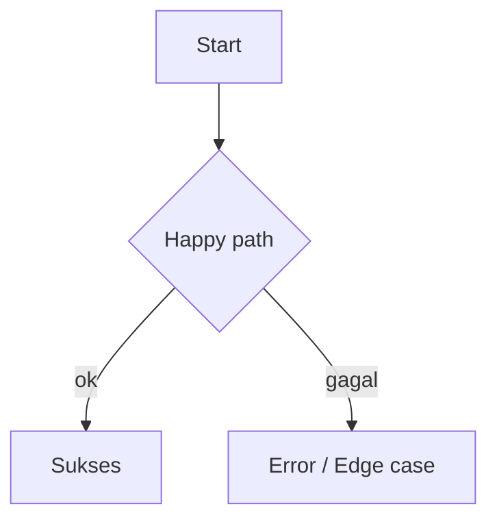

<!--
TEMPLATE: docs/01-PRD-AND-FLOW.md  (Agen #1)
INSTRUKSI: Minimal 5 FR. Setiap FR wajib punya Acceptance Criteria Given-When-Then.
Setiap FR WAJIB punya minimal satu edge case. Salin format tabel persis.
-->
# 01 — PRD & Flow

## 1. Aktor & Matriks Izin (Role Matrix)
| Aktor | Deskripsi | Boleh | Tidak Boleh |
|---|---|---|---|
| {{...}} | {{...}} | {{...}} | {{...}} |

## 2. Diagram Alur (Mermaid graph TD)

- Happy Path: {{...}}
- Edge Cases: {{koneksi putus, race condition, token expired, konflik offline, input invalid}}

## 3. Functional Requirements (MoSCoW)
| ID | Fitur | Deskripsi & Aturan Bisnis | Prioritas | Acceptance Criteria (Given-When-Then) |
|---|---|---|---|---|
| FR-01 | {{...}} | {{...}} | MUST | Given {{...}} When {{...}} Then {{...}} |
| FR-02 | {{...}} | {{...}} | SHOULD | {{...}} |

> Minimal 1 FR `MUST`. ID berurutan `FR-01`, `FR-02`, ... Jangan melompati nomor.

## 4. Non-Functional Requirements
- Performance: {{...}}
- Security: {{...}}
- Scalability: {{...}}
- Offline: {{...}}

## STATE OUTPUT
```json
{
  "prd_state": {
    "app_goal": "{{...}}",
    "actors": ["{{...}}"],
    "functional_requirements": [
      { "id": "FR-01", "feature": "{{...}}", "description": "{{...}}", "business_rules": ["{{...}}"], "priority": "MUST", "actors": ["{{...}}"], "acceptance_criteria": ["Given ... When ... Then ..."] }
    ],
    "user_flows": [ { "name": "{{...}}", "kind": "happy", "steps": ["{{...}}"] } ]
  }
}
```
